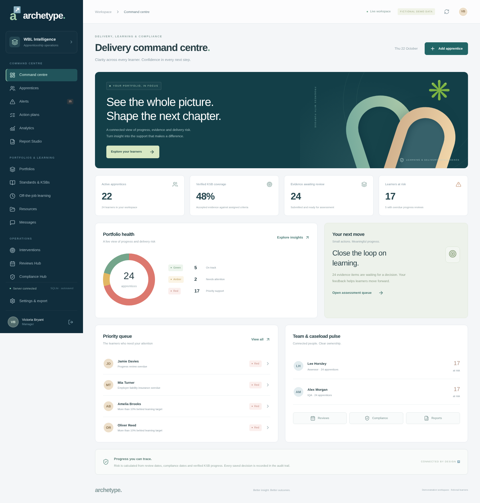
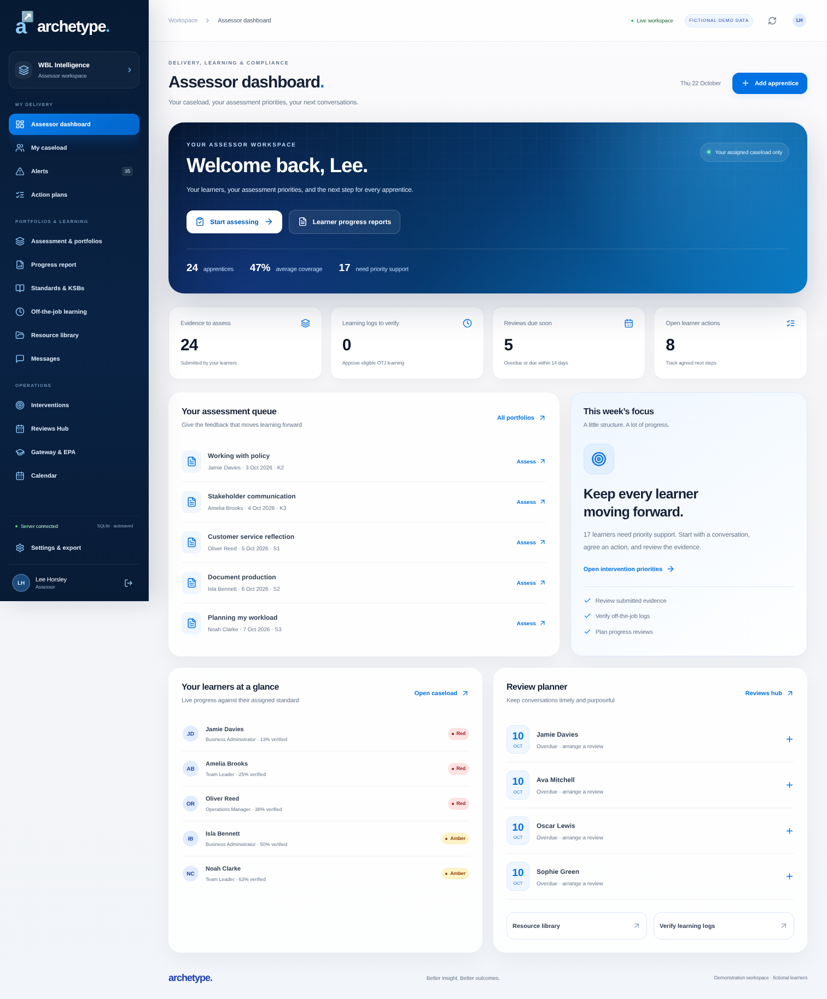
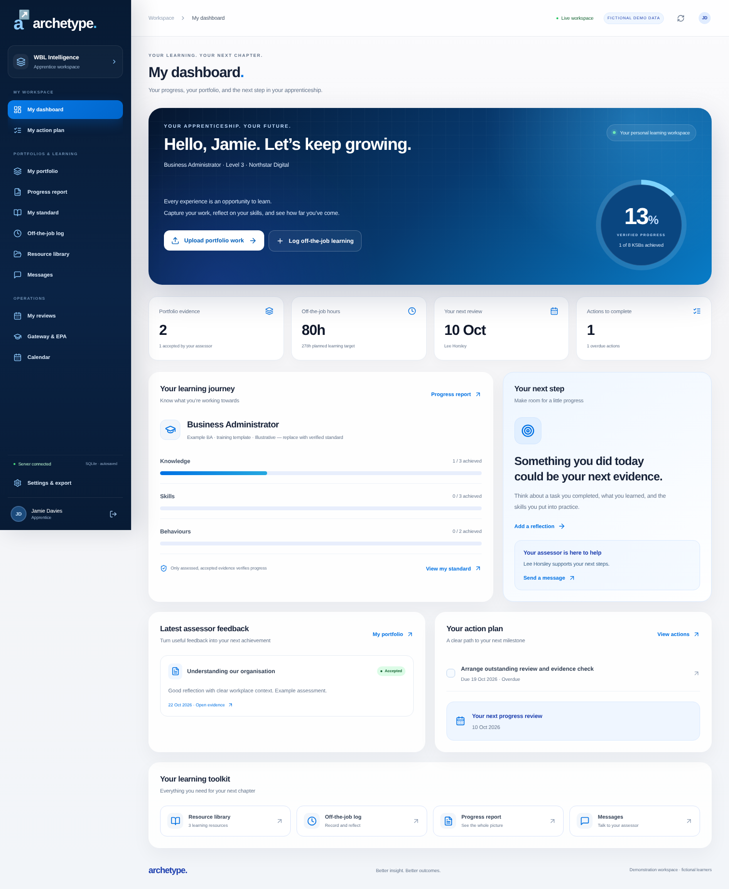
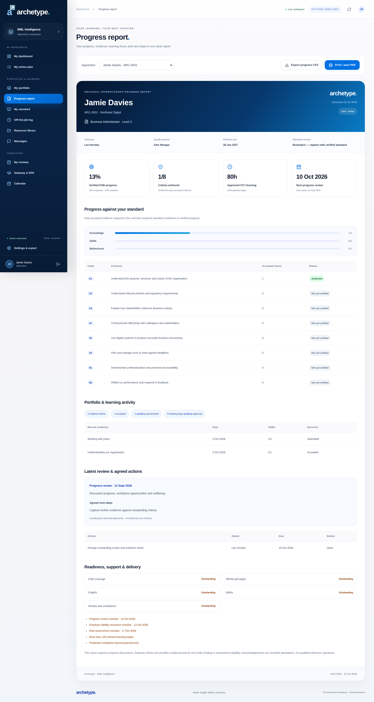
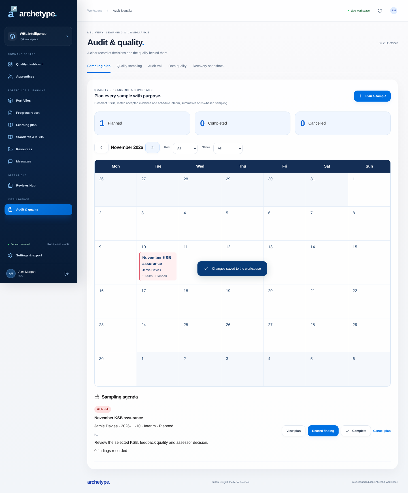

# Archetype · WBL Intelligence

A connected apprenticeship portfolio and delivery workspace, modelled on the supplied **WBL Intelligence / Uploads / AutoTracking / Standards** HTML reference. The application uses the supplied model’s final deep-navy, bright-blue and cyan palette, rounded white cards and command-centre layout. It keeps Archetype branding and provides separate master-user, assessor, apprentice, IQA and employer experiences backed by a Node.js API and persistent SQLite database.



<details><summary>See the assessor dashboard</summary>



</details>

<details><summary>See the apprentice dashboard</summary>



</details>

<details><summary>See the individual progress report</summary>



</details>

## Deploy the live system

[Deploy to Render](https://render.com/deploy?repo=https://github.com/ArchetypeCG/Archetype-Assessor) · [Full deployment, account setup and backup guide](docs/DEPLOYMENT.md)

The Render Blueprint uses a paid single-instance web service and a 10 GB persistent disk. Live mode has no public demo accounts: supply your administrator email/password securely in Render, then set a new password on first login. A generated encryption key protects daily backups. Configure a separate S3-compatible bucket for off-site disaster recovery. Render account setup, payment, credentials and launch are external steps; repository configuration alone does not publish a website.

All authorised devices use the same HTTPS address and server-held database/files. Views refresh automatically while open; changes are not written to browser localStorage. A detailed **Learning plan** now connects objectives, activities, KSBs, resources, learner reflections and scheduled teaching/review sessions. Calendar sessions include agenda, preparation, participants, room/meeting link, start/end time, attendance, outcomes and private staff notes. Accounts support forced initial password changes, manager-issued password recovery and deactivation across devices.

## Preview in GitHub Codespaces

1. Open this repository on GitHub → **Code → Codespaces → Create codespace on main**.
2. Wait for the Node 24 development container to install dependencies.
3. In the terminal run `npm run dev`.
4. Open the browser for **port 5173** from the Ports tab. Keep the port private.

Outside Codespaces, install **Node.js 24 or newer**, then run:

```sh
npm ci
npm run dev
```

Open the Local address printed by Vite. The command starts both the frontend and API; do not run just Vite. API port 3001 is internal and does not need to be forwarded. The development workspace uses fictional demonstration learners and accounts. Fresh demos include Business Administrator, Team Leader and Operations Manager templates and three starter resources. These are illustrative standards; replace them with official wording/version before delivery. Existing demo databases receive missing starter-library entries additively; existing learners, evidence and assignments are preserved.

### Demo accounts

Enter an account email and password on the sign-in screen. The public role-picker has been removed. The password for the five original demo accounts is `ArchetypeDemo2026!`.

| Role                  | Account                   | Scope                                                               |
| --------------------- | ------------------------- | ------------------------------------------------------------------- |
| Master user (Manager) | manager@archetype.demo    | All records, account creation, import and recovery                  |
| Assessor              | assessor@archetype.demo   | Assigned learners, evidence decisions, reviews and hours            |
| IQA                   | iqa@archetype.demo        | Assigned learners, standards and quality sampling                   |
| Apprentice            | apprentice@archetype.demo | Jamie Davies's own evidence, learning logs, reviews and actions     |
| Employer              | employer@archetype.demo   | Northstar Digital learners, reviews and actions; no portfolio files |

These are public demo credentials. Do not use the demo database for real learner information. Account scope is checked by the API, not just hidden in the interface.

## Implemented workflows

- **Master dashboard:** the reference’s five KPI hero, portfolio health, priority queue, team pulse, quick actions, health score, 30-day milestones, programme intelligence and compliance radar.
- **Assessor dashboard:** assigned caseload, assessment queue, pending learning logs, review planner and intervention priorities; no master account-management navigation.
- **Apprentice dashboard:** personal progress ring, K/S/B coverage, upload-work and learning-log shortcuts, latest feedback, action plan and learning toolkit.
- **IQA sampling plans:** preselect KSBs and accepted evidence, classify risk, schedule interim/summative/risk-based/follow-up samples in a visual monthly calendar, record linked findings, and require findings for all planned KSBs before completion.
- **Email recovery and reminders:** one-hour single-use password-reset links for every role, manager-triggered reset emails, and an optional 08:00 Europe/London urgent-action digest with individual preferences, persistent delivery queue and retries. [Configure email in Render](docs/EMAIL.md).
- **IQA and employer dashboards:** their own sampling priorities or employer cohort, scoped by the server.
- **Individual progress report:** verified KSBs, criterion-level coverage, evidence, approved hours, review discussion, next steps and readiness; CSV export and browser print/save PDF.
- **Apprentices:** add/edit records, assign assessor/IQA/standard, search, status/RAG filters, sorting and pagination.
- **Portfolios:** evidence files and reflections; multiple KSB mappings; draft, submit, return, revise, accept or reject; feedback and decision history.
- **Automatic tracking:** only accepted evidence contributes to KSB coverage. Approved logs calculate OTJ totals. Date and progress exceptions calculate RAG dynamically.
- **Standards:** versioned standard library, pasted K/S/B text parsing, editable extraction preview and duplicate-code validation. Example criteria are explicitly illustrative. Only one standard per course can be created; duplicate course names and references are rejected. Use **Assign standard** from the learner profile or standard library to change a programme. Earlier evidence and hours are retained against the original standard, a history entry records the reason and actor, and gateway readiness resets. Matching KSB codes from different standards do not carry progress across automatically. The regular edit/import route blocks programme changes; use the dedicated assignment action to preserve history.
- **Learning logs:** dated reflections and hours, assessor approval or return. New logs are capped at 24 hours/day per entry; historic sample logs are clearly identified.
- **Reviews:** discussion, agreed actions, automatic last/next-review updates and separate authenticated participant acknowledgements.
- **Actions and interventions:** owners, deadlines, overdue cohorts and completion/reopening.
- **Compliance:** insurance, workplace risk, employer assessments, review dates and missing-field checks.
- **Gateway/EPA:** calculated readiness checks, declaration notes, gateway/EPA dates; gateway recording is blocked until configured checks pass.
- **Resources and calendar:** protected resource uploads, HTTPS links, standard-specific resources, appointments and monthly view.
- **Messaging:** persistent account-to-account conversations; refresh to retrieve replies.
- **Reporting:** live filters, progress/date ranges, exceptions, grouping, selectable fields, CSV/XLSX exports and print/PDF.
- **Imports:** CSV/XLSX learner import with preview, reference-based upsert, name/ID mapping and atomic server validation. The first XLSX worksheet is used. Download a template inside the import dialog. The reference HTML's column names are also supported.
- **Quality and recovery:** IQA samples, actor/timestamp audit records, data-quality checks and five manager-controlled snapshots.
- **Accounts:** role-scoped sessions, password hashing, account creation and self-service password changes that invalidate existing sessions.

Spreadsheet import updates learner records. It deliberately does not convert arbitrary spreadsheet percentages into verified evidence or import passwords. Files are limited to 5 new attachments per save and 5 MB each.

## Build and validate

```sh
npm test
npm run build
npm run preview
```

`npm run preview` explicitly serves the built frontend and demo API on port 3000. It needs `npm run build` first. The test suite uses an isolated temporary database and covers permissions, evidence and files, assessment transitions, hours, review acknowledgements, messaging, IQA, imports, snapshots, concurrency, gateway, restart persistence, standard reassignment and legacy record migration.

## Storage and production startup

Database and attachment bytes are stored in `data/archetype.sqlite` (ignored by Git). They persist across process restarts. Deploy on a server with a persistent volume; ephemeral hosting will lose data. **GitHub Pages cannot host the API.** The old browser-only prototype's localStorage keys remain untouched; Settings can export those older records separately.

A separate, empty production directory and an initial administrator password are required for first startup. In a Bash shell:

```sh
npm ci
npm run build
export DATA_DIR=/absolute/persistent/path/archetype
export ADMIN_EMAIL=admin@yourorganisation.example
read -rs -p 'Initial administrator password (12+ characters): ' ADMIN_PASSWORD
export ADMIN_PASSWORD
printf '\n'
export COOKIE_SECURE=1
# Also supply BACKUP_ENCRYPTION_KEY securely (32+ characters) for scheduled encrypted backups.
npm start
```

Use a unique secret password supplied by your deployment's secret manager in a hosted environment. Production startup creates one manager and no sample learners. A manager then creates assessor/IQA accounts, standards and learners, followed by linked apprentice and employer accounts. Subsequent startups use stored password hashes. Do not point production at a demo database: the server refuses to run a database containing public demo accounts without explicit demo mode. `COOKIE_SECURE=1` requires an HTTPS reverse proxy (do not set it for plain HTTP local development).

Use an HTTPS reverse proxy and restrict network access to the application port. The API uses HttpOnly/SameSite cookies, validates request origins, limits request sizes and login attempts, and records successful workspace changes. Sessions expire after eight hours. Back up SQLite using its supported backup mechanism or stop the app and preserve the database with its WAL/SHM files together. In-app snapshots are in the same database and are not external backups. Files remain in the database after snapshot recovery so recovered evidence links still work.

## Scope and next work

The core workflows have server persistence and production deployment configuration. This is **not a certified or complete Smart Assessor replacement**. The supplied HTML is a design/workflow reference, not a production security specification. No original staff passwords or institutional branding from the file were adopted.

Before real learner use, complete provider-specific requirements and a security/accessibility review, implement malware scanning, off-site backup configuration and retention policies, configure official versioned standards and applicable funding rules, and test the deployment. There is no multi-organisation tenancy, SSO/MFA, account invitation/reset email (master-managed password recovery is available), ILR/MIS/LMS integration, EPA-provider integration, email/SMS/push notifications, live video capture, plagiarism service, or qualified electronic signature. Review acknowledgements are recorded attestations, not qualified signatures. Gateway checks support provider judgement and do not certify funding or assessment eligibility. Automated risk uses configured rules; forecasting uses entered dates, not AI.

See [docs/FEATURES.md](docs/FEATURES.md) for the functional map and remaining parity work.

<details><summary>See the IQA sampling calendar</summary>



</details>

## Requested official KSB catalogue

The four requested full current standards have **not** been imported as verified: Business Administrator L3, Digital Applications Technician L3, Team Leader L3 and Operations Manager L5. The official Skills England / IfATE sources returned network-access errors in the development environment on 23 October 2026. The uploaded reference includes only an incomplete Digital Applications Technician extract, so it is not sufficient for an authoritative import. Existing fictional learners and their example standard mappings are retained. Obtain the full official documents, confirm the current version and the digital pathway, then import the exact wording using **Standards & KSBs**. Do not treat existing training templates as the full occupational standards.
