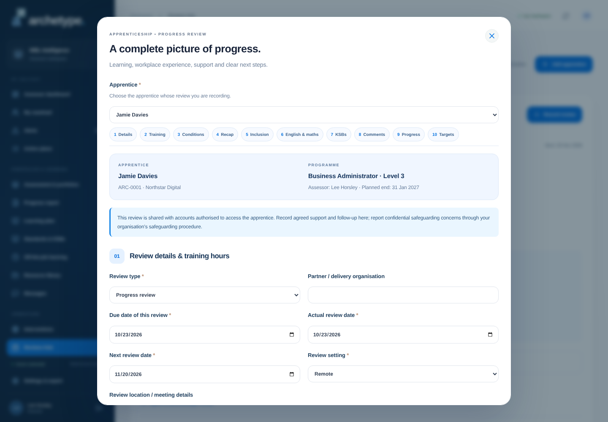

# Structured apprenticeship progress review

New reviews use a blank, structured form based on the supplied review document. Only headings, questions and workflow requirements were used. The student's details, dates, hours, comments, progress ratings, targets and signatures were not imported. Learner, employer, programme and assessor information comes from the selected platform record.

Open **Reviews Hub → Record review**, a learner's reviews tab, or **Record completed review** from a scheduled review. Choose the apprentice, then complete the ten sections. The section navigation jumps between parts of the form. Fields marked with an asterisk are required; relevant follow-up fields appear when an answer needs an explanation.

| Online section                        | Coverage                                                                                                                                                                                                                                        |
| ------------------------------------- | ----------------------------------------------------------------------------------------------------------------------------------------------------------------------------------------------------------------------------------------------- |
| Review details and hours              | Apprentice, employer, programme/level, assessor, delivery partner, location/setting, scheduled due date, actual date, next review, on-the-job and off-the-job totals                                                                            |
| Training and assessment               | OTJ evidence/authentication, other funded training, plan changes, correlation between workplace and off-the-job learning, ongoing training needs, workplace/college issues                                                                      |
| Training conditions                   | Absence/missed appointments in the last 10 weeks; accidents in the last 12 weeks, days absent and reporting; role/supervisor changes and health/safety induction; additional IAG in the last 10 weeks; PPE; existing/requested ALS and referral |
| Recall and recap                      | Previous actions, any unachieved actions and training delivered since the previous review                                                                                                                                                       |
| Inclusion, safeguarding and wellbeing | Equality/diversity/inclusion discussion, safeguarding and Prevent awareness/reporting, wellbeing and agreed support                                                                                                                             |
| Functional skills                     | English and maths development and workplace application, with separate progress ratings                                                                                                                                                         |
| KSB development                       | Separate knowledge, skills and behaviours reflections with workplace application                                                                                                                                                                |
| Impact and comments                   | Training impact on the role, learner comments and employer comments (or an explanation if unavailable)                                                                                                                                          |
| Programme progress                    | Workplace contribution, career aims, milestones, qualifications/assignments/evidence and EPA preparation; progress percentage and rating against the planned end date                                                                           |
| SMART targets                         | Specific outcomes, method/measurement, purpose, active owner, category and a due date after this review and by the next review; at least one programme/workplace and one OTJ target                                                             |
| Agreement record                      | Individual learner, employer and assigned-assessor acknowledgement statuses, signed-in names and UK date/time of agreement                                                                                                                      |

## Saving and follow-up

The server validates required sections and conditional explanations as well as the browser form. Saving creates the complete review and an open action for every SMART target in one transaction. Owners must be active users with access to the apprentice. These actions appear in action plans and qualify for the existing morning reminder workflow when due. The review updates last/next-review dates, and completing a linked scheduled review marks that calendar entry attended/completed.

Reported progress and training hours are review observations. They do not grant KSB achievement, approve a learning log or change verified progress. The saved review separately snapshots platform-approved OTJ hours, verified KSB progress, programme target and programme details. Later changes to the learner do not rewrite that historical snapshot.

The learner, employer and assessor read and acknowledge the review from their own accounts. Saving a review does not automatically acknowledge it for anyone. Names and timestamps are recorded by the server; this is not a qualified electronic-signature service. Users cannot acknowledge for someone else.

Saved records expose **View the complete review**, including all answers, targets and agreement statuses. The latest complete review is also included in the individual progress report and its browser print/save-PDF output. Earlier reviews remain readable and are not backfilled with invented answers. New API submissions must use `progress-review-v2`; callers using the old short review payload must update.

## Shared information

The review follows existing learner access permissions. Employer and apprentice accounts can see reviews for their authorised learner scope. The form explicitly asks for shared support summaries and reporting/follow-up arrangements; confidential disclosures should go through the organisation's safeguarding process. The platform does not automatically send an accident report, ALS referral or safeguarding notification to another organisation or system when a status is selected.

## Automatic reviews every 10 weeks

An administrator opens **Apprentices → select apprentice → Edit apprentice** and sets **Initial 10-week review date** and **Predicted end date**, then saves. The initial date is the first review, followed by one every **70 calendar days**, up to and including the predicted end date. No review is added after the predicted end; an extra review at the course end is not added unless it falls on the 70-day cycle.

One persistent calendar entry is shared by the assigned assessor, linked apprentice accounts and employer accounts for that apprentice's employer. The next six planned automatic reviews also appear in **Reviews Hub**. Participant links are updated when accounts are added/reactivated, disabled, or a learner's assessor/employer changes. Existing learner access checks still apply; another employer cannot access the series.

Initially the date is scheduled with **time and location to be confirmed**. Open the entry in **Calendar** and use **Edit session** to book the time, location, meeting link, agenda and other details. Editing or cancelling an individual occurrence does not move the remaining 10-week dates. Reviews cannot be moved past the predicted course end. Calendar downloads export unbooked entries as transparent date-only events, avoiding an invented meeting time or blocking an entire day.

Changing the initial date or predicted end synchronises the series without duplicating entries. Extending the end adds the additional cycles; shortening it cancels automatic plans outside the new period. Completed reviews and their contents are preserved. An existing review booked on a generated date is reused. Individually cancelled reviews are not silently reopened; cancelled entries are retained as history. Clearing the initial date stops the automatic series, and pausing/completing/withdrawing the learner cancels its open automatic plans. Resuming the active programme restores eligible plans that were automatically retired.

Recording a completed progress/tripartite review from the calendar links it directly. If recording from **Reviews Hub**, the matching scheduled due date is linked automatically. The next-review date advances to the earliest remaining automatic review. Existing reminder emails include due/overdue scheduled reviews when email delivery is configured. This does not send external meeting invitations.

Spreadsheet imports support `initialReviewDate` / `Initial Review Date`. Legacy imports with a new or changed next-review date within the predicted course end can establish the initial series when no initial date is supplied. An explicit blank initial date stops automatic scheduling. The normal initial-date control is restricted to administrators; assessors can book and reschedule individual entries.
